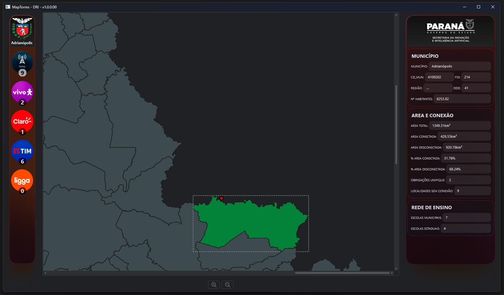
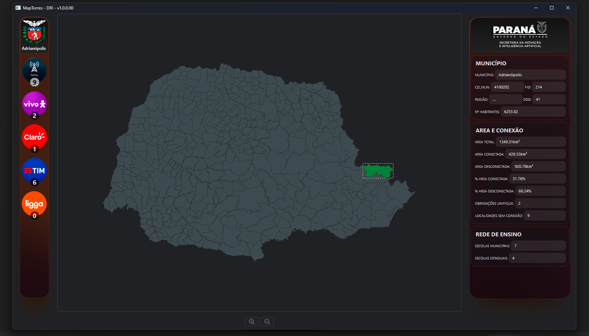

 # MapTowers v1.01
**Software de Conectividade Rural**  
Desenvolvido para a Diretoria de Relações Institucionais (DRI), vinculado à Secretaria da Inovação em Inteligência 
Artificial (SEIA), do estado do Paraná. Foi pensado de modo a complementar as apresentações do diretor do DRI, possibilitando
mostrar a disposição das torres do programa de Conectividade Rural, a cobertura das operadoras nas regiões de interesse e
demais informações.
```
**Arquivos com dados restritos da Secretaria foram omitidos, atendendo ao que determina a LGPD.**
```

 ## Interfaces da Aplicação



